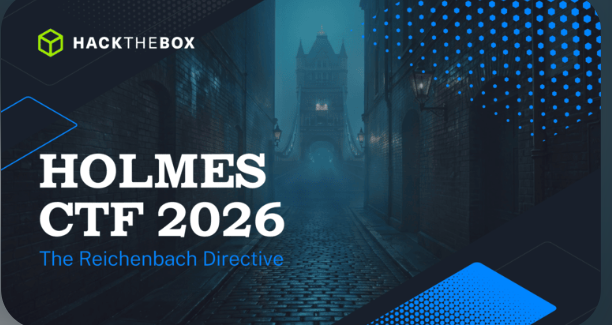

# HackTheBox — Writeups & Sherlocks

   
  HackTheBox

This folder documents my HackTheBox Sherlock investigations and Holmes CTF 2026 challenge writeups. Each Sherlock is a DFIR-style scenario where artifacts must be analyzed to reconstruct an attack chain and answer questions.

---

## Sherlocks

| Sherlock | Category | Status | Description |
|----------|----------|--------|-------------|
| **Brutus** | Log Analysis | ✅ Complete | SSH brute-force on a Confluence server — auth.log and wtmp analysis |
| **PhantomRing** | Triage | ❌ Not started | — |
| **Unit42** | DFIR | ❌ Not started | — |

### Brutus

**Scenario:** A Confluence server was brute-forced via SSH. The attacker gained root access, created a backdoor account (`cyberjunkie`), and downloaded a privilege escalation script.

**Artifacts:** `auth.log`, `wtmp` (binary), `sessions.tsv` (parsed wtmp)

**Key findings:**
- Attacker IP: `65.2.161.68`
- Compromised account: `root`
- Backdoor account: `cyberjunkie` (added to sudo)
- Downloaded script: `linper.sh` (Linux privilege escalation)

**MITRE ATT&CK:** T1110.001 (Password Guessing), T1136.001 (Create Account), T1078 (Valid Accounts)

📄 [Full writeup](Sherlocks/Brutus/README.md)

---

## Holmes CTF 2026

   
  Holmes CTF 2026

The Holmes CTF 2026 is a collection of Sherlock-style forensic challenges. Each challenge provides artifacts (memory dumps, disk images, logs, binaries) and requires answering questions about the attack chain.

### Challenges

| # | Name | Category | Status | Description |
|---|------|----------|--------|-------------|
| 01 | **SilentDividend** | Malware Analysis | ✅ Complete | Malicious Electron app — preload abuse, blockchain contract, wallet drainer |
| 03 | **WhisperChain** | — | ❌ Not started | — |
| 04 | **PaperGhost** | DFIR | ✅ Complete | USB-delivered spyware implant — SRUM, USBSTOR, triage analysis |
| 05 | **PoisonedBranch** | DFIR | 🚧 Partial | Backdoored git repo with XOR-encrypted Metasploit payload |
| 06 | **SilentPassenger** | — | ❌ Not started | — |
| — | **IronFeather** | — | ❌ Not started | — |

### SilentDividend

**Scenario:** A malicious desktop application stages files, executes PowerShell bypasses, reads an Ethereum smart contract for decryption keys, and presents a wallet-drainer UI.

**Artifacts:** Electron app (`app.asar`), `preload.js`, `flag.js`, `Dockerfile`

**Key answers:**
- Copy location: `C:\Users\Public`
- Win32 API: `WinHttpSendRequest`
- Contract function: `resolveState()`
- Payload: `AUTH=NAPOLEON SETTLEMENT_REFERENCE=SR-4821`
- Token approval: `approve()` with `maxuint256`
- Provider: `BrowserProvider`
- Coordinates: `51.5049,0.0348`

📄 [Full writeup](Holmes-CTF-2026/SilentDividend/README.md) | [Answers index](Holmes-CTF-2026/SilentDividend/answers/README.md)

### PaperGhost

**Scenario:** A USB device left by a contractor delivers a fake update package containing spyware that exfiltrates 172 MB to a C2.

**Artifacts:** KAPE triage collection (RegistryHives, LNKFilesAndJumpLists, SRUM)

**Key answers:**
- USB first connected: `2026-08-19 15:35:50`
- USB serial: `RS200000000627E4&0` (Lexar USB Flash Drive)
- Payload path: `E:\CO-LT-0469 update package\update.exe`
- Execution timestamp: `2026-08-19 15:36:00`
- Asset tag: `CO-USB-0091`
- Outbound to C2: `172.064531` MB

📄 [Full writeup](Holmes-CTF-2026/PaperGhost/README.md) | [Answers index](Holmes-CTF-2026/PaperGhost/answers/README.md)

### PoisonedBranch

**Scenario:** A backdoored git repository (`diogenes-ticket-parser`) contains an XOR-encrypted Metasploit payload that connects to a C2 at `blackpearl2026.htb:31337`.

**Artifacts:** UAC live response, git repo snapshot, XOR-encrypted payload

**Key findings:**
- Poisoned repo: `diogenes-ticket-parser` (author: `cbass.Moran@blackpearl2026.htb`)
- Payload: XOR-encrypted ELF (mettle stage) → `~/.cache/.ticket-parser/.integrity`
- C2: `203.0.113.10:31337`
- Implant PID: `1514`
- Attacker also used LFI path traversal on exposed server (`BlackPearl2026.htb:9999`)

📄 [Analysis notes](Holmes-CTF-2026/PoisonedBranch/analysis/notes.md)

---

## Tools Used

| Tool | Purpose |
|------|---------|
| `grep` / `awk` | Log analysis and pattern extraction |
| `utmpdump` | Binary wtmp/utmp parsing |
| `python3 utmp.py` | Custom wtmp parser (provided by the challenge) |
| `regipy` | Registry hive parsing |
| `dissect.esedb` | Windows Search index parsing |
| `uv` | Python environment management |

---

## Key Skills Demonstrated

- SSH brute-force detection and analysis
- Binary log parsing (wtmp/utmp)
- Attack chain reconstruction from authentication logs
- MITRE ATT&CK mapping
- SOC detection engineering (correlation rules, alerting)
- Malware analysis (Electron apps, XOR-encrypted payloads)
- Blockchain/smart contract forensics
- USB device forensics (USBSTOR, SRUM)
- Git repository supply chain attack analysis
