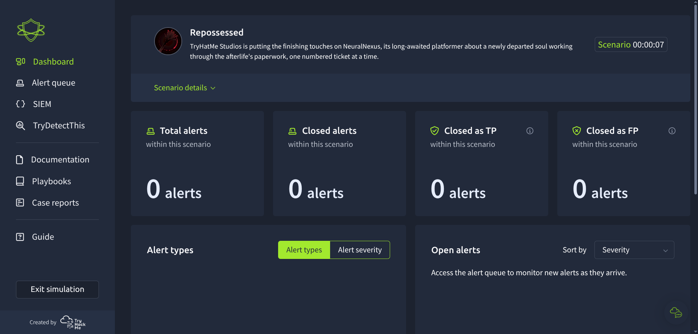
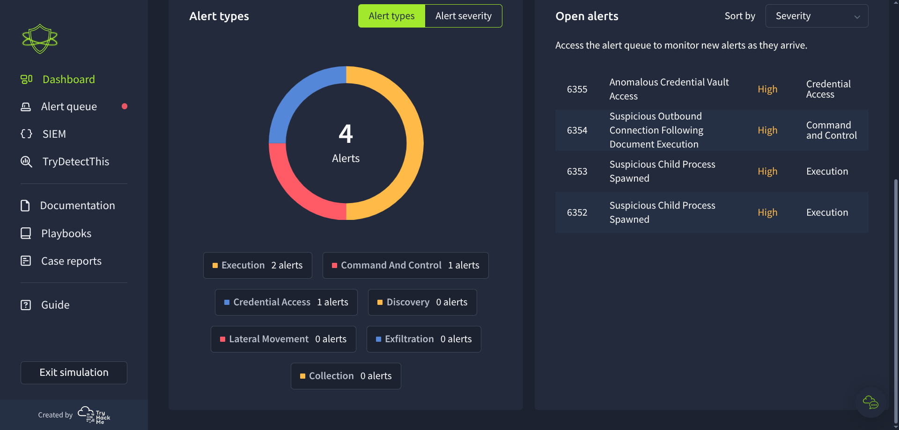
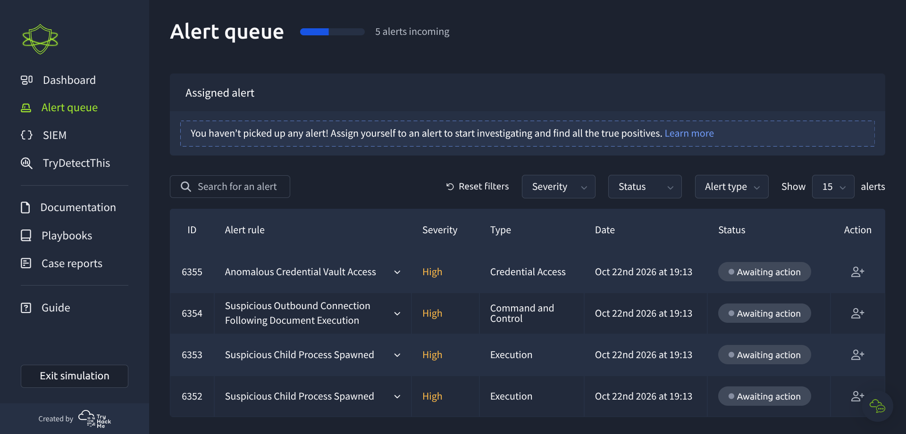

# Repossessed — SOC simulator

This is the first room in my Downtime CTF write-up. It is a seven-step SOC simulation in which I reviewed alerts, investigated the available telemetry, and recorded a triage decision.

## My alert investigations

The notes below retain my initial reasoning and add a corrected assessment where I found a gap or an unsupported conclusion. The event records are not fully consistent in their timestamps, so check the event-level time and process identifiers before treating the alerts as one chronological sequence.

| Alert | Topic | Analysis |
|---|---|---|
| 6352 | Office AI helper spawned by Word | [Alert 1](./alerts/alert-1.md) |
| 6353 | Encoded PowerShell downloader | [Alert 2](./alerts/alert-2.md) |
| 6354 | PowerShell outbound connection to `45.147.230.131` | [Alert 3](./alerts/alert3.md) |
| 6355 | Windows Credential Manager enumeration | [Alert 4](./alerts/alert4.md) |
| 6356 | Domain-account enumeration | [Alert 5](./alerts/alert5.md) |
| 6357 | Suspicious Windows service creation | [Alert 6](./alerts/alert6.md) |
| 6358 | PowerShell connection to `104.18.32.47` | [Alert 7](./alerts/alert7.md) |
| 6359 | 7-Zip archives NeuralNexus build output | [Alert 8](./alerts/alert8.md) |
| 6360 | PowerShell connection to `45.147.230.131` | [Alert 9](./alerts/alert9.md) |

When the room loads, the SOC dashboards are available:

The Alerts tab contains the cases to triage:

## Documentation

### Welcome
>⚠️ Using Sentinel? Logs can take up to 10 minutes to appear.

>Sentinel needs time to load this scenario's logs into the Log Analytics workspace, so your first alerts may arrive before the logs do. If a query returns nothing, wait a few minutes and run it again.

Get ready to step into the shoes of a Security Operations Center (SOC) analyst. This platform simulates real-world scenarios where you'll receive alerts, investigate them as needed, and take appropriate actions to resolve or close them.

Since this is a simulation, alerts may not come in rapid succession. Delays are intentional to mirror a realistic workflow and give you time to think through each case.

### Alert Triage 
Read Before You Begin
Check out the Alert Triage Playbook described below (Alert Triage tab)
Understand how to classify and escalate alerts (Alert Classification tab)
Review case report guide and best practice examples (Case Reporting tab)
Familiarise yourself with SOC notes, company's assets, and employees
Note that the provided information is beneficial for earning the highest score!
Alert Triage Playbook
Initial Alert Review:

Access the SOC Dashboard: Open the SOC dashboard and review the new alerts
Assign Alert to Yourself: Add the first (earliest) alert to the list of assigned alerts
Understand Alert Logic: Review the alert description and understand its logic
Review Alert Details: Look at the IOCs provided in the alert, like IPs and domains
Investigate in the SIEM:

Access the SIEM: Open the "SIEM" tool to access raw security events that triggered the alert
Query Related Logs: Perform searches to gather more context and build the activity timeline
Use TryDetectThis: Open TryDetectThis from the sidebar to check the threat score of found indicators
Correlate and Validate: Correlate the alert data with other data sources to validate the credibility of the alert
Resolution and Closure:

Decide on Alert Classification: Click "Write Case Report" and follow the Alert Classification guide
Write Case Report: Provide a detailed report of the triaged alert according to the Alert Reporting guide
Decide if Alert Requires Escalation: For True Positives, refer to the same guide and follow the Escalation section
Submit and Close the Alert: Once the alert is triaged, submit and close its case report in the SOC dashboard

### Alert Classification

True Positive

Classification for unauthorised access to information, threats like malware, adware, phishing, brute force, account breach, or an action that violates the company’s security policies. True Positives are often candidates for further remediation steps like host isolation, password rotation, or malware cleanup.

False Positive

Classification for activities which were determined to be legitimate, meaning those that did not have malicious intent, can’t harm the organisation, and don’t violate the security policies. False Positives are often candidates for review to improve the detection rule or fix a misconfiguration in the network.

Classification Examples

Rule "Windows Account Brute Force":
True Positive: Threat actor indeed attempted brute force, even if it was unsuccessful
True Positive: Contractor ran a brute force attack via Hydra without getting any approval
False Positive: IT misconfigured their script and it now fails to log in every minute
False Positive: The password had expired but the user tried to log in with old credentials 6 times
Rule "Login from Unfamiliar Location":
True Positive: Threat actor used an EC2 instance in the US to breach a Europe-based employee
True Positive: Threat actor used a popular VPN service to access the breached account
False Positive: A US-based employee accessed their email from a phone during a vacation in Asia
False Positive: Salesperson used an approved VPN to log in and triggered the alert
Alert Escalation
Escalation Required

True Positive alert must be escalated if additional actions or remediation are required, or if the alert belongs to a single incident (single attack chain) and is connected to other alerts that require escalation.

When Escalation IS NOT Required

An employee downloaded an unwanted or cracked software from the web, but the downloaded installer was quarantined by AV or removed by the user before execution, before any impact
A corporate mail server received an email, classified it as phishing, and quarantined it before any users had a chance to access the malicious email
Botnet scanned the corporate website for common vulnerabilities like XSS and path traversal, and the activity did not cause any performance or security issues
When Escalation IS Required

Threat actor gained access to the corporate server or workstation and ran a port or network scan from there, even if the scan was not successful or no further actions were taken
Threat actor tried to dump credentials from the breached file server via Mimikatz, but the attempt was blocked by an existing EDR solution
The alert was identified as part of a larger attack chain but was initially misclassified. Here, an analyst needs to go back and update their case report

### Alert Reporting

Best Practice Reports
True Positive - "Windows Account Brute Force"

This activity is classified as a True Positive due to detected brute force attempts from the IP address 211.219.22.213 to the CORP-11 Windows host on the TryHatMe environment. This IP is flagged as malicious on the TryDetectThis app. The attack targeted the username Bob Taylor. This activity started at 10:22 on 05.02.2025. After more than 100 unsuccessful attempts, a successful login was detected at 10:27 on 05.02.2025 from a malicious IP to Bob's account. Immediate escalation is required, as unauthorized access was detected, necessitating remediation actions like account lockout and password change.

False Positive - "Windows Account Brute Force"

This activity is classified as a False Positive. I detected that Bob Taylor attempted to log into the CORP-11 Windows host on the TryHatMe environment from the IP address 12.23.4.115. It is worth noting that this user regularly engages in activity from this IP address. During the investigation, 6 failed login attempts were found starting at 12:23 on 01.02.2025, with the reason for the failures being the user's expired password. This resulted in failed events triggering the correlation rule. No anomalies were found.

### SOC Handover Notes
1 day ago
Facilities has decorated the whole floor in black-and-white stripes for the NeuralNexus launch. If you're getting a headache, it isn't the dashboards. - Bud
Threat intel passed along a note about a crew calling itself Pinstripe Moth that has been circling game studios lately. Nothing on our side. Also, whatever you do, don't say the name three times. - Jordan
IT is trialling a new crash-report uploader on a few laptops this week and keeps kicking it off by hand to check it works. Ignore the extra admin logins. - Bud
Third call this morning about the same phishing alert. Still a false positive. - Jordan
Hide the Pain Harold meme: analyst calling me three times for a false-positive phishing alert

2 days ago
Someone from Game Development built a tiny model of the whole town for the NeuralNexus trailer and left it on the meeting-room table. Look, don't touch. - Sal
Paged the on-call at 3 AM for a real one. They'll thank me later. - Bud
Grim Reaper knocking on a door meme: me when escalating alerts, the on-call at 3 AM

3 days ago
Why are the Sentinel logs taking so long to show up? - Sal
Give it ten minutes and deal with it :) - Jen
The new-analyst handbook has been updated. Yes, it still reads like stereo instructions. Please read it anyway. - Jen
Quiet weekend. Nothing to hand over. - Bud
Waiting Skeleton meme: me waiting for the Sentinel logs to load

### Company Information 
Company Introduction
TryHatMe Studios is an up-and-coming software development house, specialising in a range of applications, from games to utilities, known for previous releases such as "CyberHeist" and the highly anticipated platformer "NeuralNexus".

Employees
Employees
Name	Email	Role	Org Unit
Michael Ascot	m.ascot@tryhatmestudios.thm	Lead Developer	Game Development
Michelle Smith	m.smith@tryhatmestudios.thm	Head of Marketing	Marketing
Luke Sullivan	l.sullivan@tryhatmestudios.thm	IT Service Delivery	IT Operations
Riley Tran	r.tran@tryhatmestudios.thm	SOC Analyst (Level 1)	Security
Sophia Reyes	s.reyes@tryhatmestudios.thm	Game Developer	Game Development
Jada Collins	j.collins@tryhatmestudios.thm	DevOps Engineer	Infrastructure
Theo Granger	t.granger@tryhatmestudios.thm	Infrastructure Architect	Infrastructure
Ava Noor	a.noor@tryhatmestudios.thm	QA Analyst	QA
Liam Patel	l.patel@tryhatmestudios.thm	Backend Developer	Game Development
Dana Brooks	d.brooks@tryhatmestudios.thm	Security Operations Lead	Security
Alex Morgan	a.morgan@tryhatmestudios.thm	SOC Analyst (Level 2)	Security

## Scenario overview

TryHatMe Studios is putting the finishing touches on NeuralNexus, its long-awaited platformer about a newly departed soul working through the afterlife's paperwork, one numbered ticket at a time. Launch is close, and the whole office has gone black-and-white stripes to celebrate.

This morning, something odd shows up in the SIEM: a Marketing workstation spawns a process it has no business spawning. Nothing has crashed, nothing looks obviously broken... but the process tree doesn't sit right.

## Scenario objectives
- Identify what caused the unusual activity observed on a workstation.

- Determine whether the activity indicates the workstation was communicating with an external party.

- Determine how the actor may have gained access to additional systems on the network.

- Assess whether any data was accessed or removed from the network.

Now let's dive into the first one, [Alert 6352](./alerts/alert-1.md).