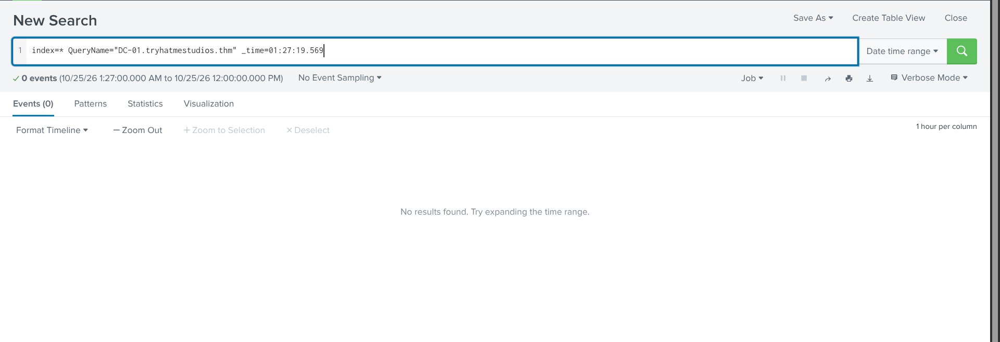

# Alert 1

- id: 6352

- alert Rule: Suspicious child process spawned

- Severity: <span style="color: orange;">High</span>   

- Type: Execution

- Date: Oct 26rd 2026 at 02:05

Description:

This detection fires when a user-facing desktop application spawns a child process. Modern office applications legitimately launch helper components, including local machine-learning and assistance features, so a match is not conclusive on its own. Where the child is a script interpreter, particularly one launched with an encoded command or with its window and execution policy suppressed, the activity warrants closer scrutiny. The analyst must inspect the path, publisher, and command line of the spawned binary, recover any concealed instructions, and determine whether code from outside the organisation has run.

CommandLine:

"C:\Program Files (x86)\Microsoft Office\root\vfs\ProgramFilesCommonX64\Microsoft Shared\Office16\AI\ai.exe" "FEA77156-AD12-420B-A641-3B46EBBA133B" "89226371-A46D-4D73-8A1B-6DA74A52D901" "6184" "C:\Program Files (x86)\Microsoft Office\Root\Office16\WINWORD.EXE" "WordCombinedFloatieLreOnline.onnx"

Company:

Microsoft Corporation

CurrentDirectory:

C:\Windows\system32\

Description:

Local Artificial Intelligence (AI) Host for the Microsoft® Windows® Operating System and Platform x64.

EventCode:

1

EventType:

4

FileVersion:

0.20.18.0

Hashes:

MD5=82341DD9F4BF17ED8DB9D2548D0BDB9F,SHA256=C217D74AABFD0DBBF3BDCDE5F077DABDC62EA8D927AA26E96B9AFA9CB3F1FA80,IMPHASH=02FA6BD3A9379F6611BD543EB86D66D8

Image:

C:\Program Files (x86)\Microsoft Office\root\vfs\ProgramFilesCommonX64\Microsoft Shared\Office16\AI\ai.exe

IntegrityLevel:

Medium

LogName:

Microsoft-Windows-Sysmon/Operational

LogonGuid:

{3af46175-c39c-6a8f-e030-9c0000000000}

LogonId:

0x9C30E0

OpCode:

Info

OriginalFileName:

ai.exe

ParentCommandLine:

"C:\Program Files (x86)\Microsoft Office\Root\Office16\WINWORD.EXE" /n "C:\Users\m.smith\Downloads\Q3_PressKit_Feedback.docm" /o ""

ParentImage:

C:\Program Files (x86)\Microsoft Office\root\Office16\WINWORD.EXE

ParentProcessGuid:

{3af46175-3906-6a90-921d-000000001200}

ParentProcessId:

6184

ParentUser:

TRYHATME\m.smith

ProcessGuid:

{3af46175-3907-6a90-961d-000000001200}

ProcessId:

6304

Product:

Local AI

Sid:

S-1-5-18

SidType:

0

SourceName:

Microsoft-Windows-Sysmon

TaskCategory:

Process Create (rule: ProcessCreate)

TerminalSessionId:

4

Type:

Information

User:

[ "NOT_TRANSLATED", "TRYHATME\\m.smith" ]

category:

Process Create (rule: ProcessCreate)

event_id:

46149

host:

THM-MSMITH.tryhatmestudios.thm

timestamp:

10/25/2026 01:27:19.569

datasource:

WinEventLog:Microsoft-Windows-Sysmon/Operational


The sequence is:
Smith , unknown user from the list of employees list triggers opening the .docm file.
Windows resolves the file association , launches WINWORD.EXE with that file path as an argument.
Word starts up and, as part of its own initialization, spawns or connects to ai.exe to enable AI features.

the file extension can be something dangerous , i will query that in splunk but weirdly in the logs at this timestamp, nothing is seen, i don't understand, so i will close it for the moment , huge chance of <span style="color: green;">False Positive</span> 


### Report
```
Time of Activity: 01:27:19.569

List of Related Entities: ai.exe ;  WINWORD.EXE; Q3_PressKit_Feedback.docm

Reason for Classifying as False Positive: No relevant logs seen in the splunk interface, the alert involves legitimate tools with no clue on their missuse.
```

I will mark this as true positive with escalation (SIEM not giving much index=* User="NOT_TRANSLATED" ndex=* User="NOT_TRANSLATED").

I will classify as true positive with escalation just for the http download .

