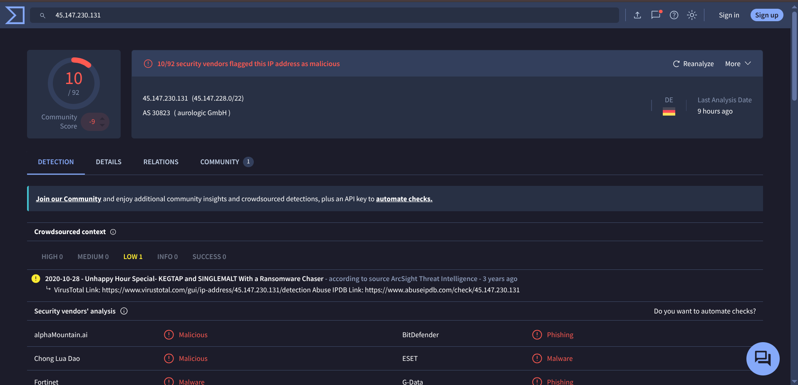

# Alert 2

- id: 6354

- alert Rule: Suspicious outbound  following document creation 

- Severity: <span style="color: orange;">High</span>   

- Type: Command and Control

- Date: Oct 24rd 2026 at 01:09

Description:

This detection fires when a host establishes repeated outbound connections to an external address shortly after a document-handling process chain has run on that host. Connections to the same destination are aggregated, so a single alert represents a pattern rather than one connection, and the analyst is expected to establish how many occurred and over what interval. Code that has only just started executing and immediately reaches infrastructure with no business relationship to the organisation is a common indicator of command-and-control activity, though some line-of-business and update tooling behaves similarly. The analyst must identify the process that opened the connection and characterise the destination infrastructure.

DestinationIp:

45.147.230.131

DestinationPort:

8067

EventCode:

3

EventType:

4

Image:

C:\Windows\SysWOW64\WindowsPowerShell\v1.0\powershell.exe

Initiated:

true

LogName:

Microsoft-Windows-Sysmon/Operational

OpCode:

Info

ProcessGuid:

{3af46175-3907-6a90-951d-000000001200}

ProcessId:

8572

Protocol:

tcp

Sid:

S-1-5-18

SidType:

0

SourceIp:

10.60.10.22

SourceName:

Microsoft-Windows-Sysmon

SourcePort:

54331

TaskCategory:

Network connection detected (rule: NetworkConnect)

Type:

Information

User:

[ "NOT_TRANSLATED", "TRYHATME\\m.smith" ]

category:

Network connection detected (rule: NetworkConnect)

event_id:

46159

host:

THM-MSMITH.tryhatmestudios.thm

timestamp:

10/24/2026 01:07:28.474

datasource:

WinEventLog:Microsoft-Windows-Sysmon/Operational


Playbook : At [playbok](https://tryhackme.com/soc-sim/playbook/de3bae14-f480-4354-b4e8-94a3a083d578) Unusual Network Connection Detection - Windows Environment
This playbook provides step-by-step guidelines for SOC Level 1 analysts to investigate unusual network connection activity in a Windows environment. This involve unexpected or suspicious connections, communication with unknown external IPs or lateral movement attempts. The playbook helps analysts review key log data, assess involved processes, and determine whether the activity is malicious.

This is again done by smith , here using powershell he tried to initiate a connection to the ip `45.147.230.131`. I don't have much things to look for here , so check the ip in virus total shows its manners so verdict is <span style="color: red;">True positive</span> .




### My report 
```
Time of activity: ct 24rd 2026 at 01:09

List of Affected Entities: The machine from where the connection was made

Reason for Classifying as True Positive: The unknown user smith run it with powershell 
the destination IP was flagged dangerous by Virustotal

Reason for Escalating the Alert: This alert needs to be investigated in depth to catch communication between the host and the malicious IP

Recommended Remediation Actions: Look further at network analysis to see what communications were made with the IP

List of Attack Indicators: User: Smith
powershell
IP
```