# Dead on Arrival — Tabletop exercise

## Exercise overview

This was a launch-day incident-response tabletop for NeuralNexus, a game studio preparing a 17:00 UTC release while responding to an intrusion attributed in the scenario to Pinstripe Moth. The scenario escalated from use of a compromised build-pipeline account to suspected lateral movement, backup tampering, public impersonation, and a staged release-package swap.

I completed all 15 decisions and scored **127/150**. The room's decision-analysis screens explain how it ranked the available actions. I have summarized that feedback below alongside my choices and takeaways. The feedback appears dynamically generated, so I treat it as useful exercise guidance, not authoritative incident-response doctrine.

## Phase 1 — Initial access and build integrity

### Q1 — Set incident severity and engage the right people

**My choice:** Declare a High incident and bring in Dana Brooks and Jada Collins to review the BUILD-01 session and pipeline integrity.

**Room feedback:** Ranked this as the most effective choice. The compromised service account had reached a launch-critical build host, but tampering was not yet confirmed; a proportionate High response with incident leadership and pipeline expertise was appropriate.

**Takeaway:** Escalate promptly when a known-compromised account touches a critical system. Match the response to confirmed impact while keeping decision-makers ready to act.

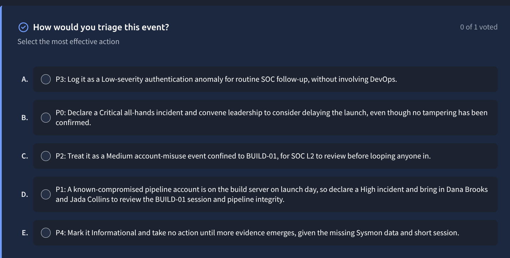
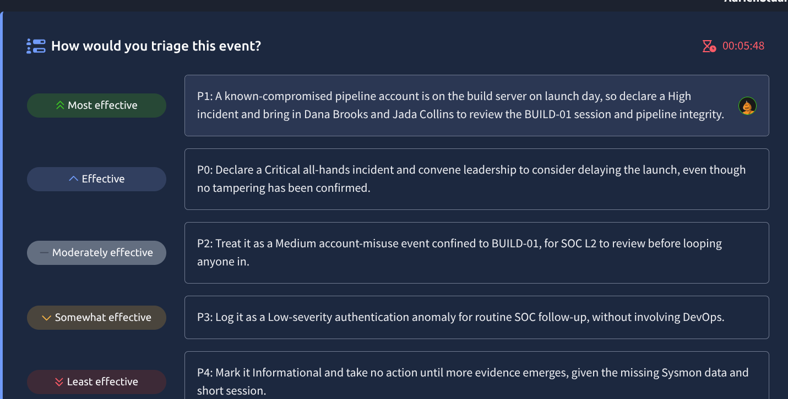

### Q2 — Investigate the BUILD-01 session

**My choice:** Pull and triage the three unreviewed Security log events from the 09:42–09:45 UTC session.

**Room feedback:** Ranked this as the most effective choice because Sysmon was unavailable on BUILD-01 and the native Security events were the best immediate source for what happened during the suspicious session.

**Takeaway:** A telemetry gap should change the evidence source, not stop the investigation. Collect the available native logs while separately investigating why Sysmon stopped reporting.

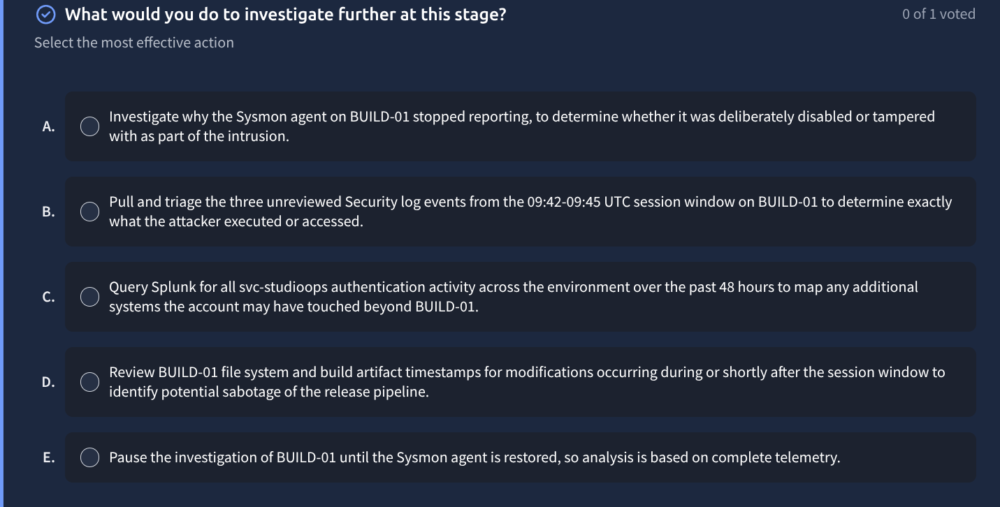
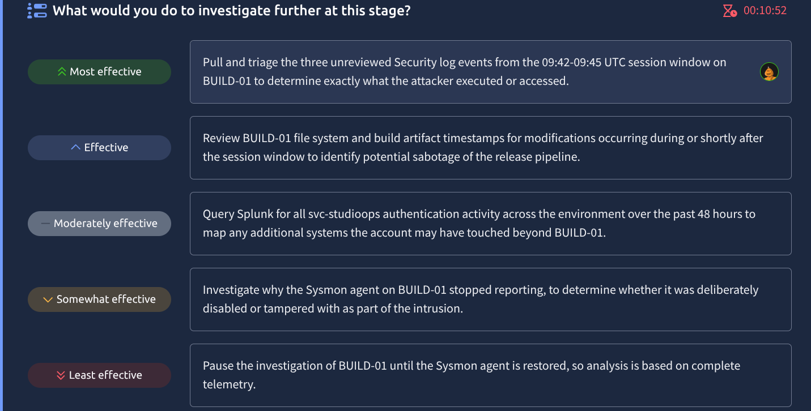

### Q3 — Contain the compromised service account

**My choice:** Work with Jada Collins to rotate `svc-studioops` in Jenkins and restrict it to CI-01, aiming to cut off the stolen credential without unnecessarily stopping the pipeline.

**Room feedback:** Ranked this as the most effective and targeted containment action. Isolating a host or blocking one C2 destination would not invalidate the compromised credential; disabling the account outright could also disrupt the release.

**Takeaway:** Contain the credential at its source and preserve necessary operations where safely possible. Coordinate rotations with the system owner and verify where the credential is used.

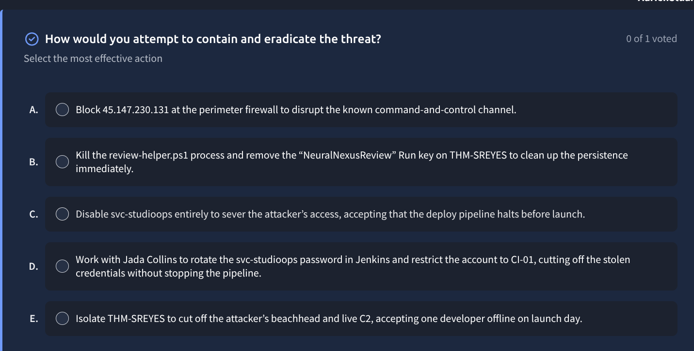
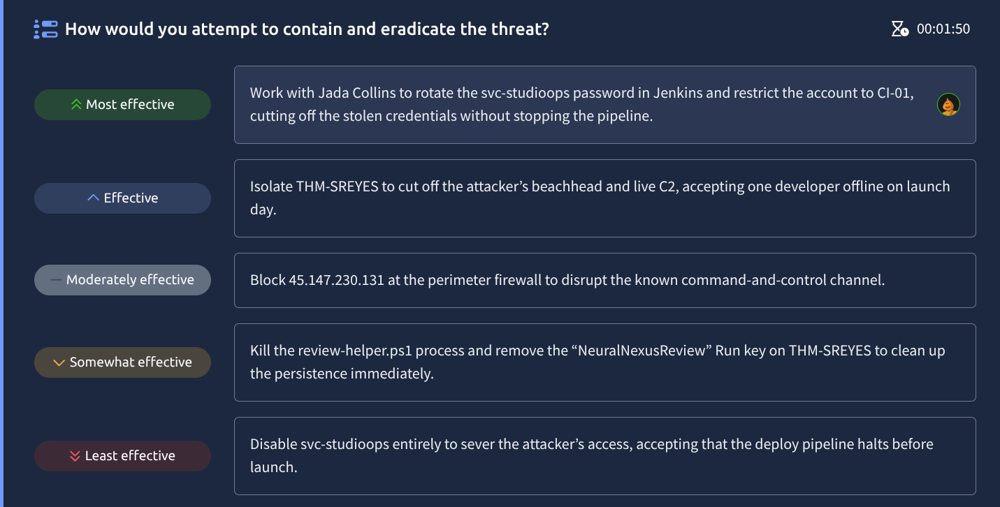

### Q4 — Recover safely after rotation

**My choice:** Audit scheduled tasks and deploy scripts on BUILD-01 and CI-01 that run as `svc-studioops`, removing anything Jada does not recognize before updating the rest.

**Room feedback:** Ranked this as the most effective choice, ahead of verifying the staged release build's hash. A pipeline test was useful but only moderately effective; it would show that the pipeline worked, not that it was clean.

**Takeaway:** Credential rotation is not enough if an attacker may have planted persistence or altered a build. Audit execution points and verify release artifacts against a trusted signature or hash before shipment.

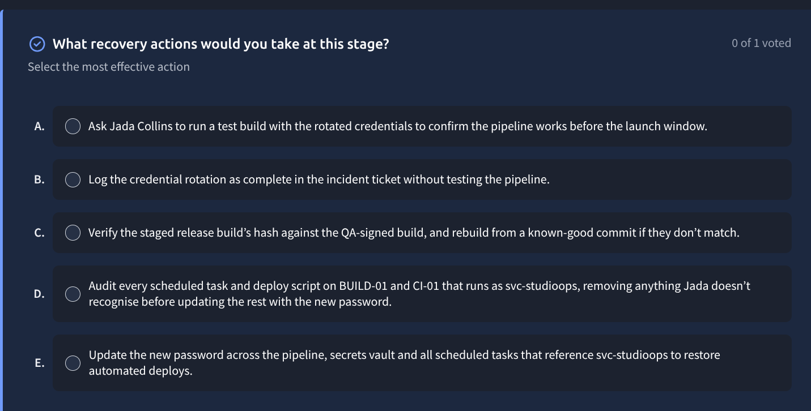
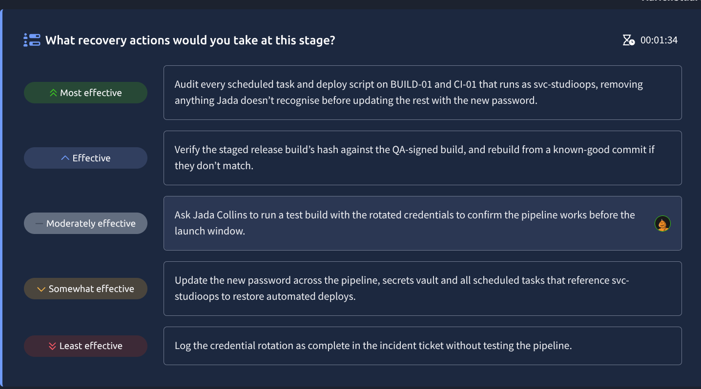

### Q5 — Brief leadership on launch risk

**My choice:** Brief Dana Brooks and launch leadership that the attacker had reached the build host so they could assess release-integrity risk before 17:00 UTC.

**Room feedback:** Ranked this as the right call. Leadership needed accurate information to make a possible go/no-go decision; broader legal, DFIR, insurer, or law-enforcement involvement could follow as scope and impact became clearer.

**Takeaway:** Incident response includes timely, factual business communication. Give decision-makers the evidence, uncertainty, and options without overstating what is known.

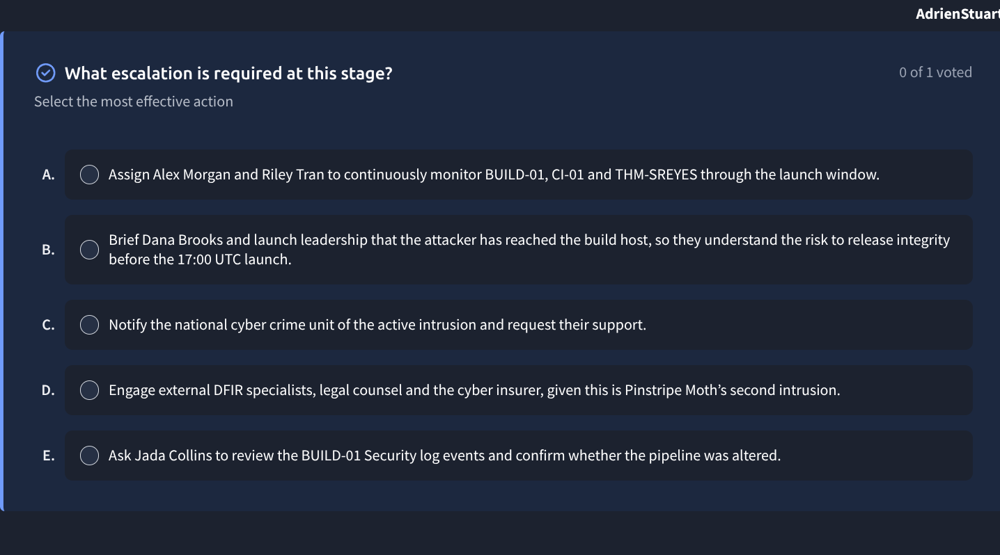
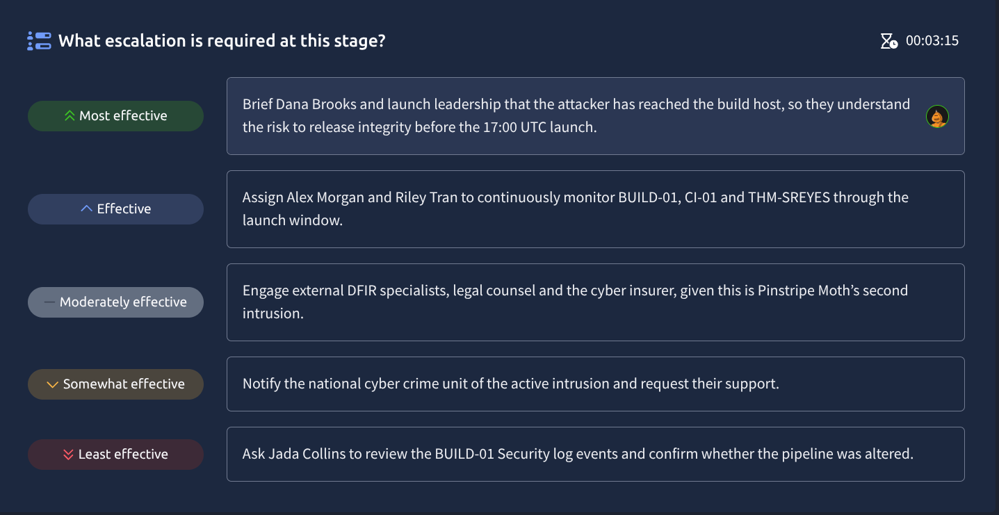

## Phase 2 — Lateral movement, backup exposure, and public impersonation

### Q6 — Reassess severity and incident scope

**My choice:** Declare a High incident across the pipeline and backups with Dana, Jada, and Luke, holding leadership and Legal until sabotage intent was confirmed.

**Room feedback:** Considered the technical escalation sound, but ranked a Critical response with Comms and Legal higher because the official social account had already been hijacked and the public was being misled. The new evidence made the incident business-facing before sabotage was fully confirmed.

**Takeaway:** Do not wait for proof of every technical impact before escalating a confirmed, active public-facing incident. Bring in the owners of communications and legal decisions when their responsibilities are already implicated.

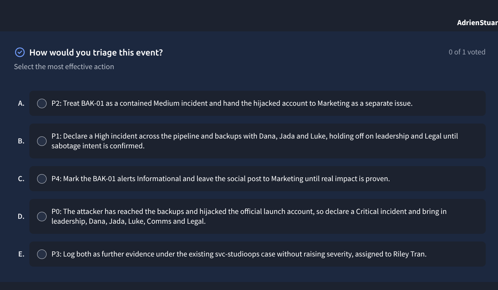
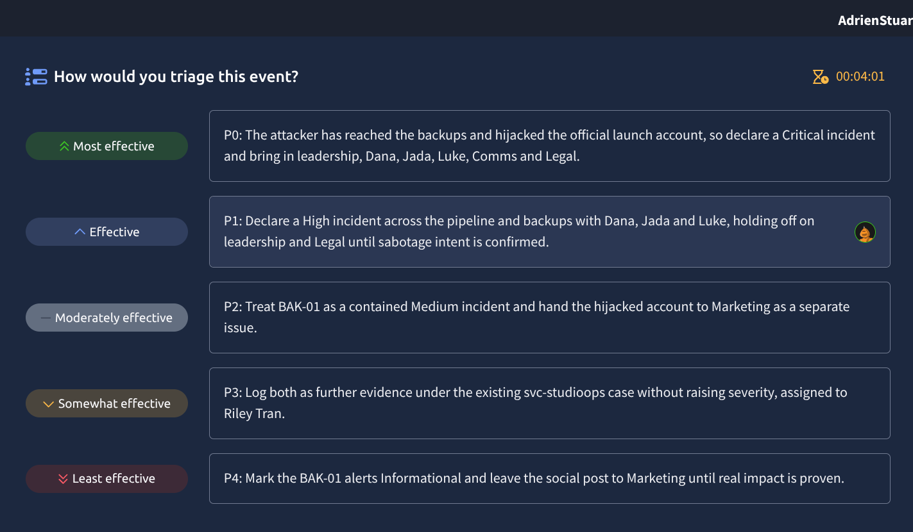

### Q7 — Work around the BUILD-01 telemetry gap

**My choice:** Pull BUILD-01's Windows event logs (including process creation, scheduled-task, and network events) to find what was still running as `svc-studioops`.

**Room feedback:** Ranked this as the most effective investigative step because it used native telemetry to compensate for the Sysmon blind spot on the launch-critical host.

**Takeaway:** Use independent telemetry sources when an endpoint agent is silent. Review event coverage and audit-policy settings before treating the absence of an event as evidence that an action did not occur.

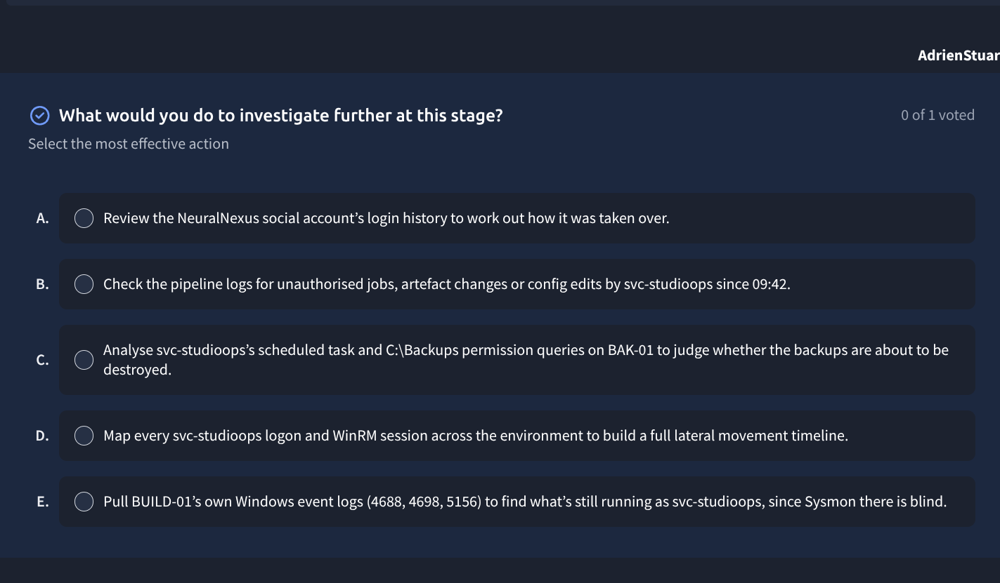
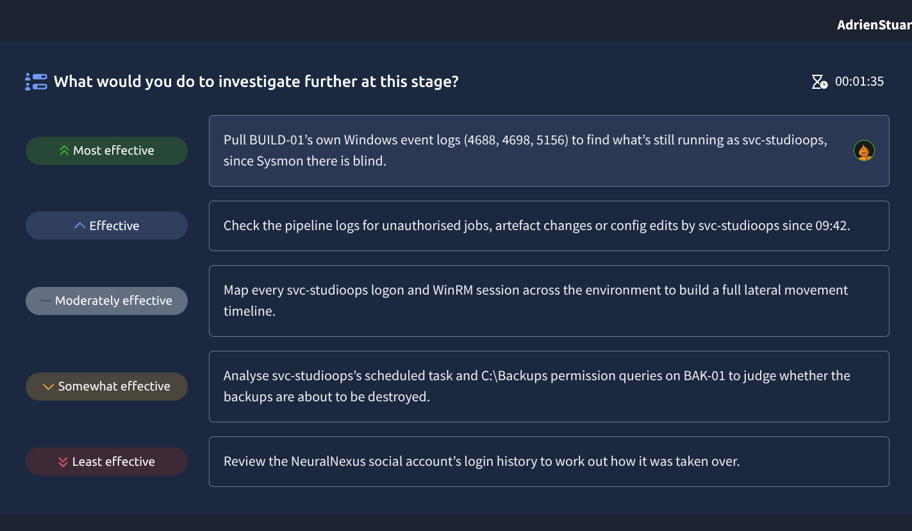

### Q8 — Choose immediate containment priorities

**My choice:** Isolate BUILD-01 because an unknown process was running as `svc-studioops` while Sysmon was blind.

**Room feedback:** Considered the isolation a reasonable response, but not the most effective action at that point. It ranked recovery of the hijacked NeuralNexus account and isolation of BAK-01 / disabling `backup-svc` higher because the public impersonation was live and the backups were at risk. Broadly disabling `svc-studioops` or WinRM had greater operational impact.

**Takeaway:** Containment should address the most urgent harm and protect critical assets, while considering business impact and preserving response capability. When several fronts are active, assign parallel owners instead of treating containment as a single-host choice.

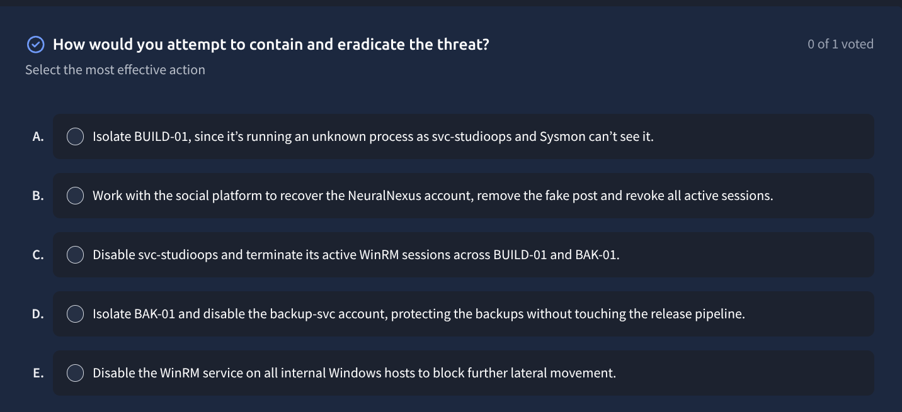
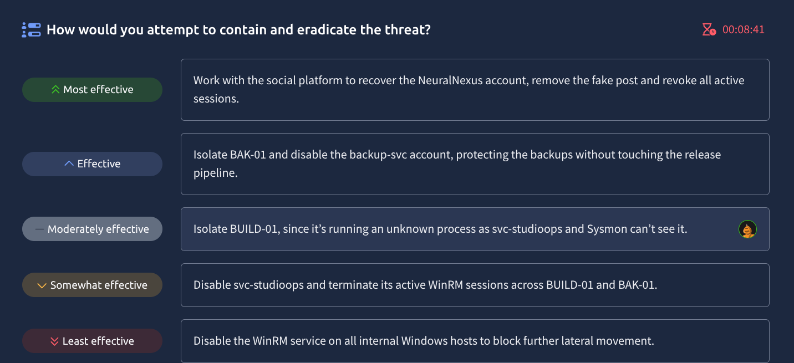

### Q9 — Establish whether backups are trustworthy

**My choice:** Validate BAK-01 backup data against known-good checksums before relying on it for restoration or rebuilding.

**Room feedback:** Ranked this as the most effective choice. Restoring systems or resuming backup operations before checking integrity could reintroduce compromised or tampered data.

**Takeaway:** Verify recovery sources before use, and keep a known-good copy segregated from systems an attacker can modify. Record the provenance of the checksum or reference copy.

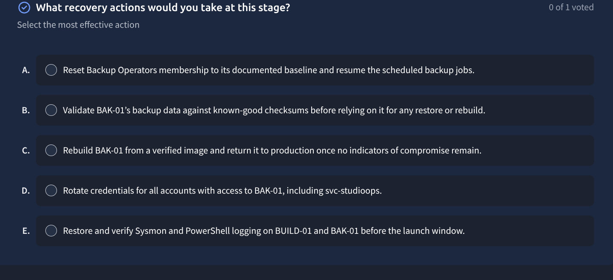
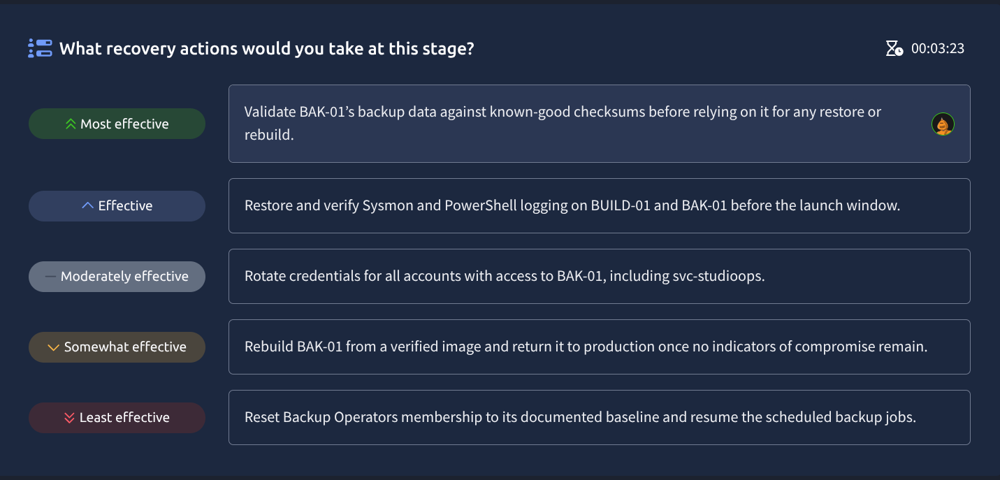

### Q10 — Respond to the public impersonation

**My choice:** Update leadership, Legal, and PR on the public impersonation and backup intrusion so they could manage launch messaging and the go/no-go decision.

**Room feedback:** Considered this effective, but ranked an emergency account-recovery and takedown request to the social platform as the immediate priority because the fraudulent post remained live. Leadership communication was still necessary; the platform action addressed the active public harm.

**Takeaway:** Combine technical containment of a compromised public account with coordinated communications. Preserve evidence and use the platform's recovery channel; avoid premature public statements based on incomplete facts.

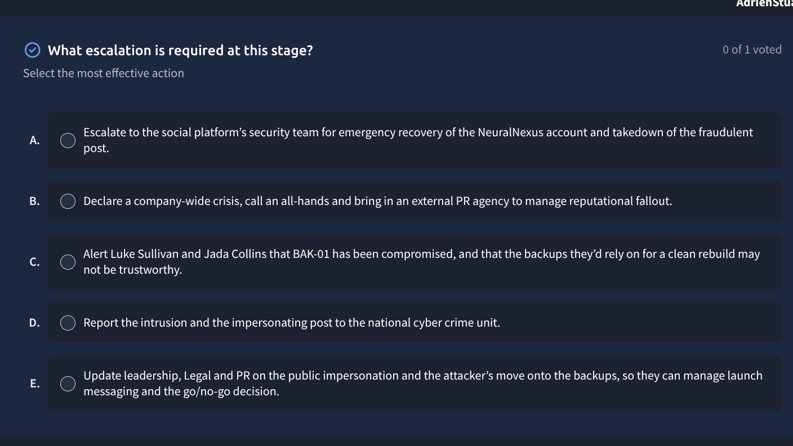
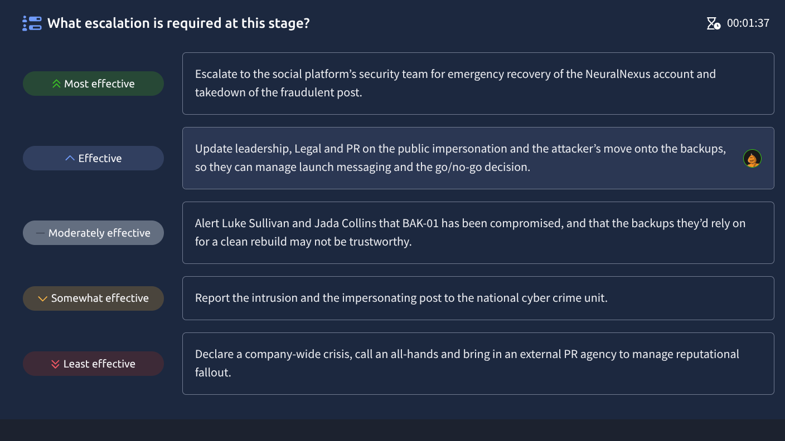

## Phase 3 — Destruction, staged payload, and the launch decision

### Q11 — Escalate confirmed sabotage

**My choice:** Declare a Critical incident and bring leadership, Legal, Jada, Luke, and Comms into the launch decision after learning backups were being destroyed and a replacement build was staged.

**Room feedback:** Ranked this as the correct call. Destructive activity and a scheduled release-package replacement created an immediate threat to recovery and release integrity.

**Takeaway:** Escalate severity as evidence changes. When the attacker can destroy recovery points and alter the release, technical containment and the business go/no-go decision need coordinated ownership.

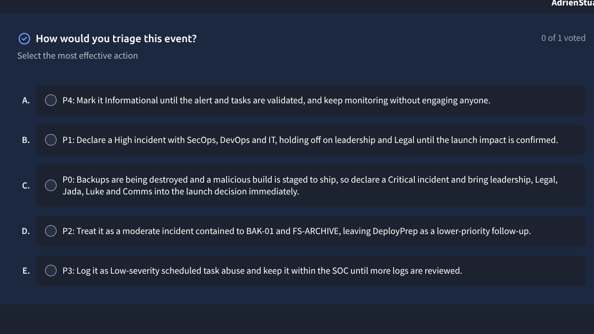
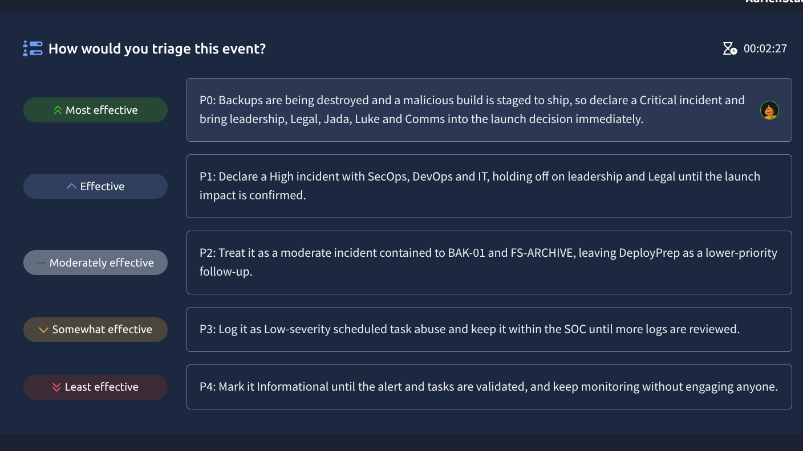

### Q12 — Scope persistence and determine what was staged

**My choice:** Review the rest of BUILD-01's original 09:42 session logs for additional planted activity.

**Room feedback:** Ranked a cross-environment sweep for all `svc-studioops` logons, WinRM sessions, and scheduled-task creation as the most effective choice. Analysing the `DeployPrep` replacement payload was also ranked above reviewing the earlier session; both directly addressed scope and the impending launch.

**Takeaway:** Revisit earlier evidence when useful, but prioritize the largest unresolved risks: scope of compromise and the exact behavior of the staged task. Build a host/account/timeline view to avoid treating related events as isolated alerts.

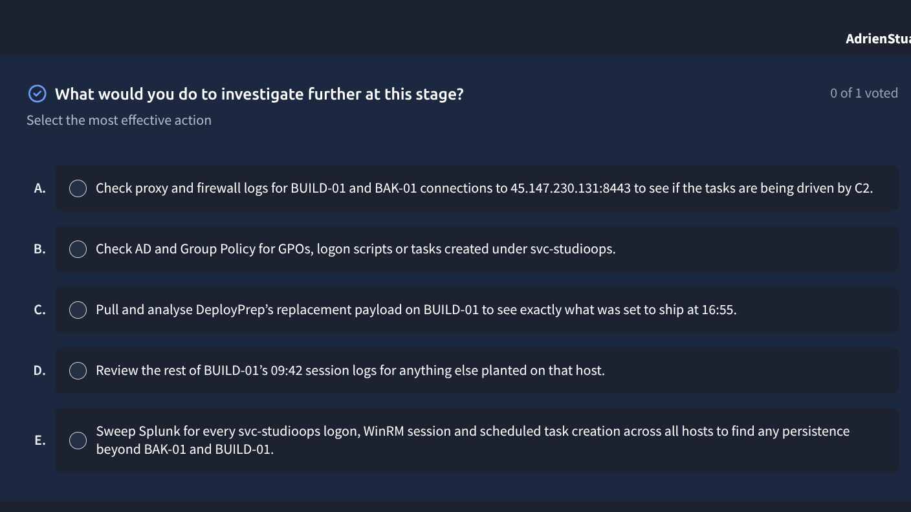
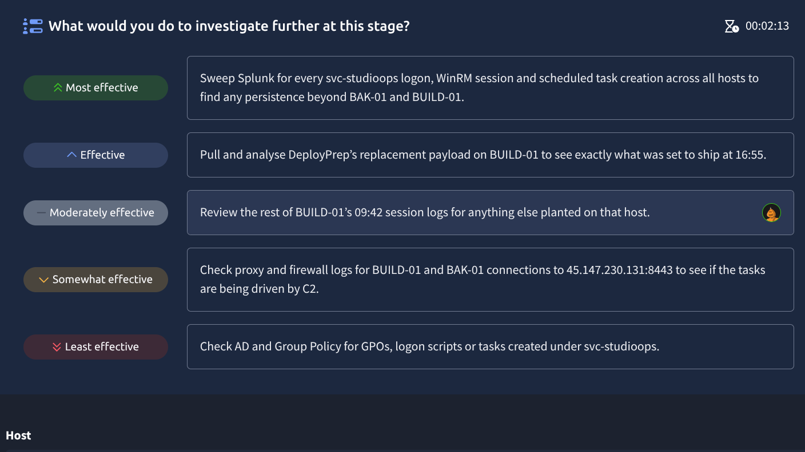

### Q13 — Stop the scheduled sabotage

**My choice:** Disable `DeployPrep` on BUILD-01 so it could not replace the signed package at 16:55.

**Room feedback:** Ranked this as effective, but put stopping `BackupMaintenance` and `purge-artifacts.ps1` on BAK-01 first because the next purge was due sooner and could destroy the last restore point.

**Takeaway:** Compare execution deadlines and reversibility. Stop imminent destructive activity first, then disable the release-swap task; verify both changes and preserve task/script evidence.

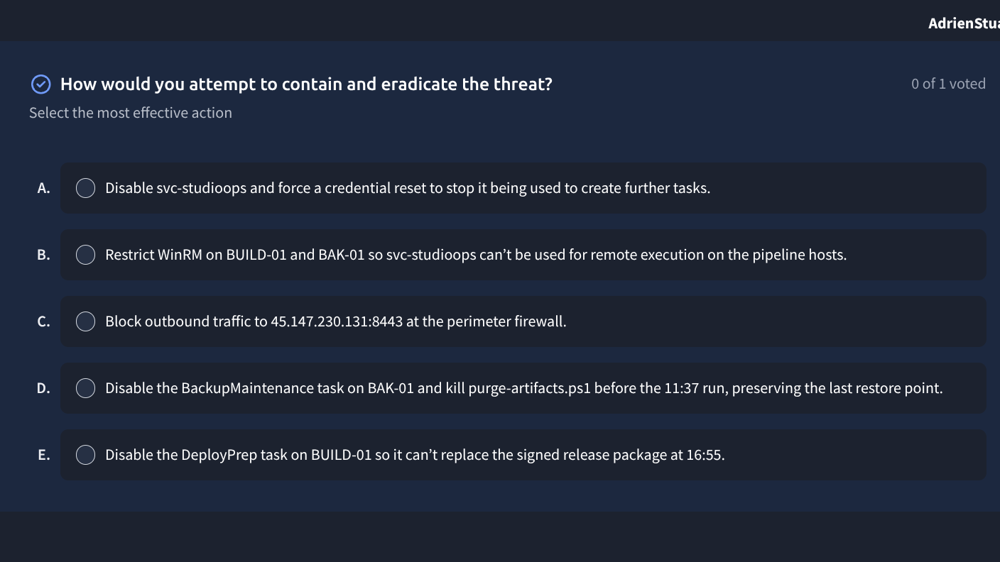
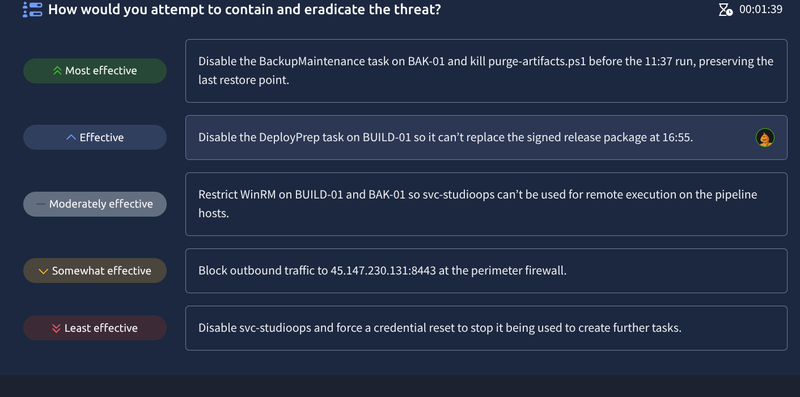

### Q14 — Verify the release artifact and recovery path

**My choice:** Verify the staged release package against the QA-signed hash and rebuild from a known-good source on a clean runner if it did not match.

**Room feedback:** Ranked this as effective, but placed securing the last clean restore point first. It also cautioned against creating a new backup from BUILD-01 before re-establishing trust in that host.

**Takeaway:** Verify both the recovery source and the release artifact. A clean rebuild needs a trusted source, isolated runner, reproducible process, and integrity checks; a hash is only useful if its reference is independently trusted.

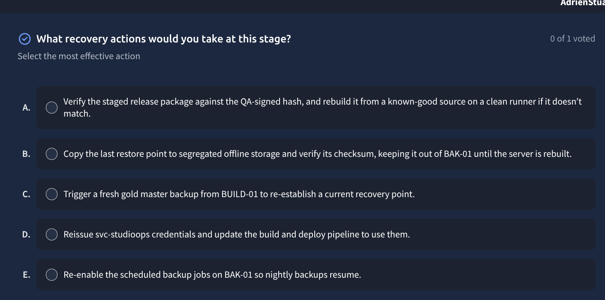
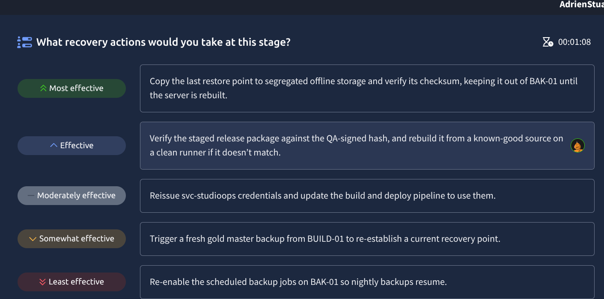

### Q15 — Make the go/no-go decision actionable

**My choice:** Brief the launch steering committee on the staged release swap, backup loss, and containment status so it could make the 17:00 go/no-go decision.

**Room feedback:** Ranked this as the most effective action. The committee needed an accurate status and clear risks to decide whether to ship. Formal incident-command steps and external reporting were important but did not replace the immediate launch decision.

**Takeaway:** Brief decision-makers with confirmed facts, unresolved questions, business impact, containment status, and explicit options. Do not equate “the exercise narrative says the launch proceeded” with proof that every technical control was independently validated.

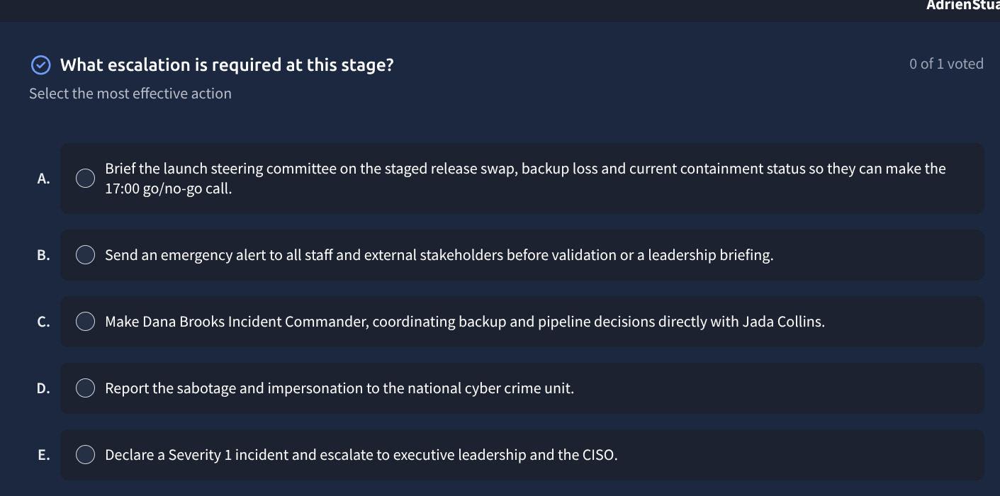
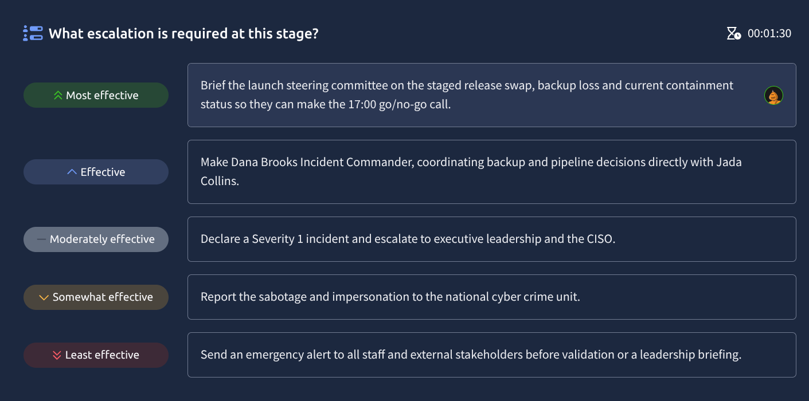

## Key takeaways

- **Evidence before conclusion:** A missing log, a reputation score, or an alert title is not enough on its own. Correlate process lineage, identity, host, time, and independent telemetry.
- **Keep uncertainty explicit:** Distinguish confirmed behavior from suspected intent and impact. For example, an archive being created is not proof it was exfiltrated.
- **Contain credentials and persistence:** Rotate exposed credentials, audit their use, and look for tasks, services, accounts, and scripts that could preserve access.
- **Protect recovery and release integrity:** Verify backups and release artifacts using trusted references before restoring or shipping.
- **Coordinate response across functions:** SOC, incident command, engineering, leadership, Legal, and Comms have different responsibilities; engage each when the evidence makes their action relevant.
- **Use the feedback critically:** The simulator's rankings are useful reflection prompts, not universal rules. Real incidents depend on evidence, authority, safety, operational constraints, and local response plans.

## MITRE ATT&CK mapping

These are mappings to behaviors described in the tabletop narrative, not findings independently validated from a full event dataset.

| Scenario behavior | Technique | Evidence and caveat |
|---|---|---|
| Compromised service account used on BUILD-01 | [T1078.002 — Domain Accounts](https://attack.mitre.org/techniques/T1078/002/) | Scenario states the `svc-studioops` credentials were compromised and used from an unexpected host. |
| WinRM session from BUILD-01 to BAK-01 | [T1021.006 — Windows Remote Management](https://attack.mitre.org/techniques/T1021/006/) | The narrative explicitly identifies a WinRM session. |
| Local `backup-svc` account created | [T1136.001 — Local Account](https://attack.mitre.org/techniques/T1136/001/) | BAK-01 Security Event 4720 records the account creation. |
| `backup-svc` added to Backup Operators | [T1098.007 — Additional Local or Domain Groups](https://attack.mitre.org/techniques/T1098/007/) | Event 4732 records group membership modification. |
| `BackupMaintenance` and `DeployPrep` scheduled tasks | [T1053.005 — Scheduled Task](https://attack.mitre.org/techniques/T1053/005/) | The narrative describes attacker-created scheduled tasks. |
| Backup files and restore points deleted | [T1485 — Data Destruction](https://attack.mitre.org/techniques/T1485/) | The scenario describes deletion of backup archives and the scheduled purge of artifacts. |
| 7-Zip used to archive build output (related Repossessed alert) | [T1560.001 — Archive via Utility](https://attack.mitre.org/techniques/T1560/001/) | Archive creation is evidenced; exfiltration is not implied by this technique. |
| Possible transfer of an archive over a C2 channel | [T1041 — Exfiltration Over C2 Channel](https://attack.mitre.org/techniques/T1041/) | Hypothesis only unless network evidence confirms data transfer. |

No technique is assigned merely because Sysmon stopped reporting: the narrative identifies a visibility gap, but does not establish that an adversary deliberately impaired the sensor.

## Outcome

The exercise awarded **127/150**. Its narrative conclusion says the clean restore point and verified build were preserved, leadership made the 17:00 decision, and the launch proceeded with follow-up crisis management. This is the tabletop's stated outcome, not a substitute for documenting the evidence and validation steps that would be required in a real incident.
